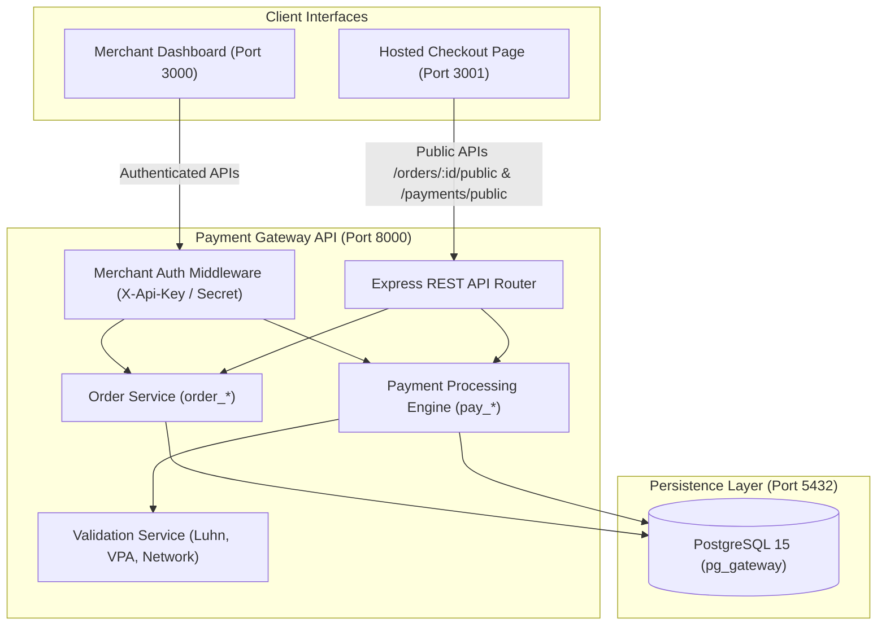
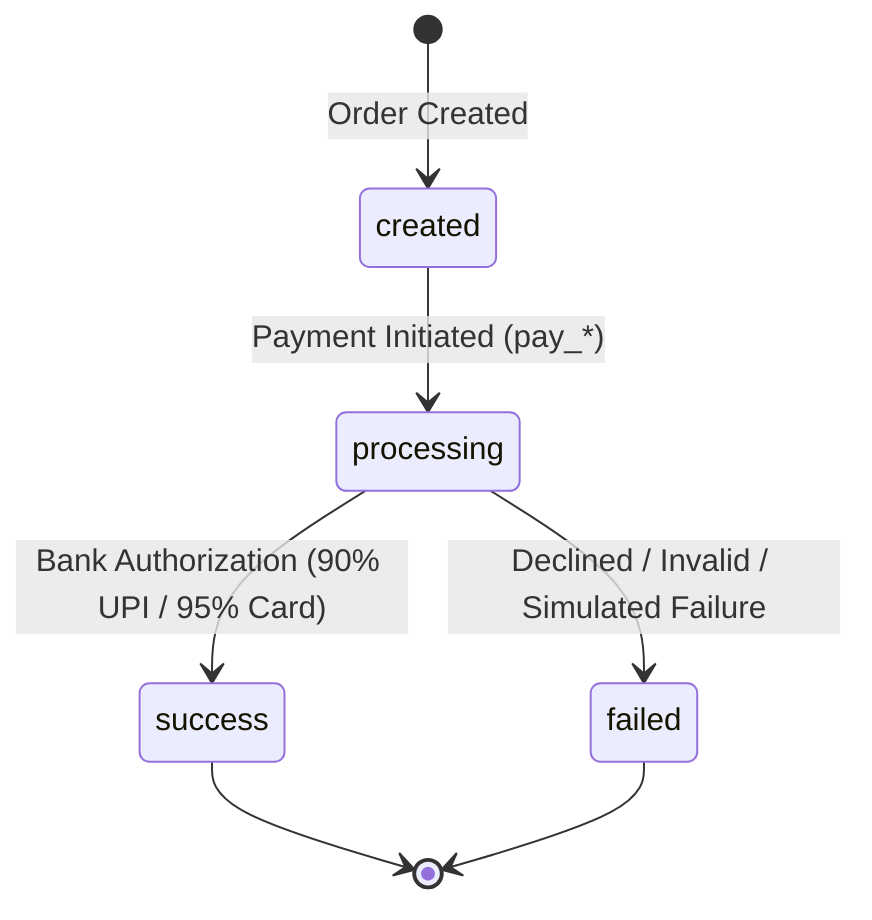

# Payment Gateway - Production-Ready Architecture & Hosted Checkout

A robust, secure, and production-grade Payment Gateway simulation built with Node.js/Express, PostgreSQL, and React. This project implements the core transactional infrastructure of systems like Stripe or Razorpay, including merchant onboarding, order lifecycle management, multi-method payment processing (UPI and Cards), deterministic evaluation modes, a merchant analytics dashboard, and a hosted checkout interface.

---

## 🏗️ System Architecture & Data Flow



### Payment State Machine Lifecycle


---

## 🚀 Quick Start (Docker Compose)

The entire multi-tier system (PostgreSQL database, Backend API, Merchant Dashboard, and Hosted Checkout Page) is fully containerized and starts with a single command:

```bash
docker compose up -d --build
```
*(Or `docker-compose up -d --build` depending on your Docker CLI version)*

### Service Endpoints & Health Check
| Service | Host URL / Port | Container Name | Description |
|---|---|---|---|
| **Health Check** | `http://localhost:8000/health` | `gateway_api` | Database connectivity & status |
| **Merchant Dashboard** | `http://localhost:3000/login` | `gateway_dashboard` | Analytics & credentials |
| **Hosted Checkout** | `http://localhost:3001/checkout?order_id=...` | `gateway_checkout` | Customer payment interface |
| **PostgreSQL Database** | `localhost:5432` | `pg_gateway` | Relational transactional persistence |

---

## 🔑 Pre-Seeded Test Merchant Credentials

On initial application startup, the database automatically seeds a test merchant idempotently:

* **Merchant ID:** `550e8400-e29b-41d4-a716-446655440000`
* **Name:** `Test Merchant`
* **Email:** `test@example.com`
* **API Key:** `key_test_abc123`
* **API Secret:** `secret_test_xyz789`

Use these credentials to authenticate API requests or to log into the Merchant Dashboard at `http://localhost:3000/login`.

---

## 📋 API Specification Reference

### 1. Health Check
`GET /health`
* **Authentication:** None
* **Success Response (200 OK):**
```json
{
  "status": "healthy",
  "database": "connected",
  "timestamp": "2026-10-24T00:30:00.000Z"
}
```

### 2. Create Order
`POST /api/v1/orders`
* **Headers:**
  * `X-Api-Key: key_test_abc123`
  * `X-Api-Secret: secret_test_xyz789`
  * `Content-Type: application/json`
* **Request Body:**
```json
{
  "amount": 50000,
  "currency": "INR",
  "receipt": "receipt_123",
  "notes": {
    "customer_name": "John Doe"
  }
}
```
* **Success Response (201 Created):**
```json
{
  "id": "order_NXhj67fGH2jk9mPq",
  "merchant_id": "550e8400-e29b-41d4-a716-446655440000",
  "amount": 50000,
  "currency": "INR",
  "receipt": "receipt_123",
  "notes": {
    "customer_name": "John Doe"
  },
  "status": "created",
  "created_at": "2026-10-24T00:30:00.000Z"
}
```

### 3. Retrieve Order
`GET /api/v1/orders/{order_id}`
* **Headers:** `X-Api-Key`, `X-Api-Secret`
* **Success Response (200 OK):** Returns complete order details.
* **Error Response (404 Not Found):**
```json
{
  "error": {
    "code": "NOT_FOUND_ERROR",
    "description": "Order not found"
  }
}
```

### 4. Create Payment
`POST /api/v1/payments`
* **Headers:** `X-Api-Key`, `X-Api-Secret`, `Content-Type: application/json`
* **Request Body (UPI):**
```json
{
  "order_id": "order_NXhj67fGH2jk9mPq",
  "method": "upi",
  "vpa": "user@paytm"
}
```
* **Request Body (Card):**
```json
{
  "order_id": "order_NXhj67fGH2jk9mPq",
  "method": "card",
  "card": {
    "number": "4111111111111111",
    "expiry_month": "12",
    "expiry_year": "2028",
    "cvv": "123",
    "holder_name": "John Doe"
  }
}
```
* **Success Response (201 Created):**
```json
{
  "id": "pay_H8sK3jD9s2L1pQr",
  "order_id": "order_NXhj67fGH2jk9mPq",
  "amount": 50000,
  "currency": "INR",
  "method": "card",
  "card_network": "visa",
  "card_last4": "1111",
  "status": "processing",
  "created_at": "2026-10-24T00:31:00.000Z"
}
```

### 5. Retrieve Payment Status
`GET /api/v1/payments/{payment_id}`
* **Headers:** `X-Api-Key`, `X-Api-Secret`
* **Success Response (200 OK):**
```json
{
  "id": "pay_H8sK3jD9s2L1pQr",
  "order_id": "order_NXhj67fGH2jk9mPq",
  "amount": 50000,
  "currency": "INR",
  "method": "card",
  "card_network": "visa",
  "card_last4": "1111",
  "status": "success",
  "created_at": "2026-10-24T00:31:00.000Z",
  "updated_at": "2026-10-24T00:31:01.000Z"
}
```

### 6. Public Checkout Endpoints
* `GET /api/v1/orders/{order_id}/public`: Retrieves public order details (`id`, `amount`, `currency`, `status`) without requiring merchant authentication.
* `POST /api/v1/payments/public`: Submits payment from the hosted checkout page. Validates that the order exists and belongs to an active merchant.
* `GET /api/v1/payments/{payment_id}/public`: Public payment status polling for the checkout browser session without disclosing sensitive merchant secrets.

### 7. Evaluation Test Endpoint
`GET /api/v1/test/merchant`
* **Authentication:** None
* **Success Response (200 OK):**
```json
{
  "id": "550e8400-e29b-41d4-a716-446655440000",
  "email": "test@example.com",
  "api_key": "key_test_abc123",
  "seeded": true
}
```

---

## 🔒 Security & PCI-DSS Compliance Architecture

1. **Cardholder Data Protection (Zero PAN/CVV Persistence):**
   * Full 16-digit primary account numbers (PAN) and CVV codes are strictly kept in-memory during validation.
   * Only the card network (e.g., `visa`, `mastercard`) and the sanitized last 4 digits (`card_last4`) are stored in the PostgreSQL database.
   * The database schema contains zero columns for full card numbers or security codes.
2. **Standardized Error Handling:**
   * Error responses consistently follow fintech formatting standards with unambiguous codes: `AUTHENTICATION_ERROR`, `BAD_REQUEST_ERROR`, `NOT_FOUND_ERROR`, `PAYMENT_FAILED`, `INVALID_VPA`, `INVALID_CARD`, `EXPIRED_CARD`.
3. **Database Connection Pool Management:**
   * Handlers for `SIGINT` and `SIGTERM` are registered in `backend/src/config/db.js` to gracefully terminate database connections on container shutdown.

---

## 🧪 Payment Validation Logic

* **VPA (Virtual Payment Address) Validation:**
  Regex pattern: `^[a-zA-Z0-9._-]+@[a-zA-Z0-9]+$`
* **Luhn Algorithm (MOD-10 Check):**
  Full algorithmic implementation verifying card checksums from right to left, doubling alternate digits.
* **Card Network Detection:**
  * **Visa:** Starts with `4`
  * **Mastercard:** Starts with `51` through `55`
  * **American Express:** Starts with `34` or `37`
  * **RuPay:** Starts with `60`, `65`, or `81` through `89`
  * **Unknown:** Any other prefix
* **Expiry Date Validation:**
  Supports both 2-digit (`28`) and 4-digit (`2028`) years. Enforces valid months (1–12) and rejects past dates relative to current year/month.

---

## ⚙️ Test Mode Configuration for Automated Evaluation

Set the following environment variables in `.env` or Docker Compose to enable deterministic automated evaluation:

```ini
TEST_MODE=true
TEST_PAYMENT_SUCCESS=true   # Force deterministic success (or false for failure)
TEST_PROCESSING_DELAY=1000  # Exact processing delay in milliseconds
```

When `TEST_MODE=false`, the gateway runs in realistic simulation mode (5–10s random processing delay, 90% UPI success rate, 95% Card success rate).

---

## 🖥️ Frontend Applications & Automated Testing Selectors

Both frontend applications strictly implement the required `data-testid` attributes required for Playwright, Cypress, and Selenium end-to-end testing:

### Merchant Dashboard (Port 3000)
* `/login`: `data-testid="login-form"`, `email-input`, `password-input`, `login-button`
* `/dashboard`: `data-testid="dashboard"`, `api-credentials`, `api-key`, `api-secret`, `stats-container`, `total-transactions`, `total-amount`, `success-rate`
* `/dashboard/transactions`: `data-testid="transactions-table"`, `transaction-row`, `payment-id`, `order-id`, `amount`, `method`, `status`, `created-at`

### Hosted Checkout Page (Port 3001)
* `/checkout?order_id=...`: `data-testid="checkout-container"`, `order-summary`, `order-amount`, `order-id`, `payment-methods`, `method-upi`, `method-card`, `upi-form`, `vpa-input`, `card-form`, `card-number-input`, `expiry-input`, `cvv-input`, `cardholder-name-input`, `pay-button`, `processing-state`, `processing-message`, `success-state`, `payment-id`, `success-message`, `error-state`, `error-message`, `retry-button`.

---

## 🧪 Running Local Verification Tests

Run the backend unit and integration test suite:

```bash
cd backend
npm test
```

Run the frontend `data-testid` contract test:

```bash
node --test tests/frontend-contract.test.js
```
